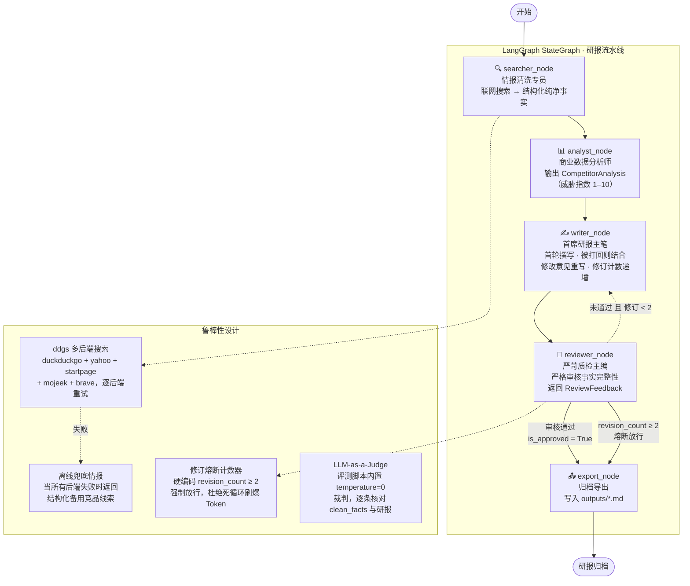

# ReportAgent · Multi-Agent 竞品研报生成系统

基于 **FastAPI + LangGraph StateGraph + DeepSeek** 的生产级多智能体协作系统，输入竞品名称，自动完成联网检索 → 情报清洗 → 商业分析 → 研报撰写 → 严苛质检 → 修订熔断 → 导出归档全流程。

## 项目背景

在 AI Agent 井喷式演进的背景下，竞品情报的获取、清洗与商业分析高度依赖人工，且面临三大痛点：

1. **一手情报碎片化**：多来源、多语言、真假混杂，人工清洗成本高。
2. **分析与写作割裂**：数据分析师与研报主笔之间缺乏强类型契约，导致事实在传递中被润色成"编造"。
3. **缺乏防幻觉闭环**：单次生成 + 事后补救，无法在生成链路中实时校验事实忠实度。

本项目的设计目标：**让每一份自动生成的竞品研报，都具备可审计的事实来源、可追溯的修订历史、以及防死循环的熔断机制。**

## 系统架构

### 多智能体协同与质检循环（Mermaid）



### 核心设计原则

| 原则 | 实现方式 |
|------|----------|
| 强类型交接 | Agent 之间仅传递 Pydantic `BaseModel`（`CompetitorAnalysis`、`ReviewFeedback`、`ReportTeamState`），禁止全量传递杂乱原文 |
| 全链路异步 | 所有 LangGraph 节点均为 `async def`，模型调用使用 `await llm.ainvoke()` |
| 防死循环熔断 | 质检 → 写作的循环边配置硬计数器，`revision_count >= 2` 时强制放行进入导出节点 |
| 离线兜底 | 搜索工具内置 `try...except`，任何网络环境下均返回结构化备用线索，保证流程 100% 跑通 |
| DeepSeek 兼容 | 所有 `with_structured_output()` 显式传入 `method="function_calling"`，防止 DeepSeek 接口 400 报错 |
| 可观测性 | FastAPI `X-Trace-ID` 请求追踪中间件 + 标准 `logging`，可选挂载 Langfuse |

## 目录分层

```
reportAgent/
├── app/                         # 核心业务代码（严格分层）
│   ├── config.py                # 环境变量加载、模型初始化、提示词加载
│   ├── schemas.py               # Pydantic 数据契约：CompetitorAnalysis / ReviewFeedback / ReportTeamState
│   ├── tools.py                 # 异步联网搜索工具（ddgs 多后端 + 离线兜底）
│   ├── nodes.py                 # 5 个 LangGraph 异步节点实现
│   ├── graph.py                 # StateGraph 组装 + 条件循环边 + 熔断路由
│   └── main.py                  # FastAPI 入口：CORS / Trace ID / REST API / UI 路由
├── prompts.yaml                 # 外置的 4 角色系统提示词
├── report_ui.html               # 极简前端展示页（Markdown 预览 + 指标卡片）
├── outputs/                     # 运行时自动生成的研报 .md 文件（.gitignore 屏蔽）
├── tests/
│   ├── eval_report.py           # 批量准确率评测脚本（三项硬指标 + LLM-as-a-Judge）
│   └── report_eval_summary.json # 评测日志（批量运行后自动生成）
├── .env.example                 # 环境变量模板（提交到仓库但不含真实密钥）
├── .gitignore                   # 屏蔽 .env / .venv / outputs / 缓存
├── requirements.txt             # 依赖清单
└── .trae/rules/project_rules.md # 项目开发规范（供 AI 编码代理使用）
```

## 本地运行指南

### 环境要求

- **Python 3.11+**
- pip / venv（Windows 上直接使用 `py -3 -m venv`）
- 有效的 **DeepSeek API Key**（项目默认对接 `deepseek-chat`，兼容任何 OpenAI 格式端点）

### 1. 克隆与依赖安装

```powershell
git clone https://github.com/caiji123487877666/ReportAgent.git
cd ReportAgent

# 创建虚拟环境
py -3 -m venv .venv

# 激活虚拟环境（Windows PowerShell）
.\.venv\Scripts\Activate.ps1

# 安装依赖（使用清华镜像加速）
py -3 -m pip install -r requirements.txt -i https://pypi.tuna.tsinghua.edu.cn/simple
```

### 2. 配置环境变量

```powershell
# 复制模板
copy .env.example .env

# 编辑 .env，填入真实 API Key：
#   OPENAI_API_KEY=sk-xxxxxxxxxxxxxxxx
#   OPENAI_BASE_URL=https://api.deepseek.com/v1
#   OPENAI_MODEL=deepseek-chat
```

`.env.example` 完整模板：

```env
OPENAI_API_KEY=
OPENAI_MODEL=deepseek-chat
OPENAI_BASE_URL=https://api.deepseek.com/v1
OPENAI_API_BASE_URL=https://api.deepseek.com/v1

# 可选：Langfuse 追踪
LANGFUSE_PUBLIC_KEY=
LANGFUSE_SECRET_KEY=
LANGFUSE_HOST=https://cloud.langfuse.com
```

### 3. 启动服务

```powershell
.\.venv\Scripts\python.exe -m uvicorn app.main:app --host 127.0.0.1 --port 8000
```

启动成功后访问：

| 地址 | 说明 |
|------|------|
| http://127.0.0.1:8000 | 前端展示页（输入竞品名称即可一键生成） |
| http://127.0.0.1:8000/docs | Swagger API 文档 |
| POST /api/generate_report | 接收 `{"target_company": "Dify"}`，异步运行状态图并返回完整研报 |

### 4. 调用接口（可选）

```powershell
# PowerShell
Invoke-RestMethod -Uri http://127.0.0.1:8000/api/generate_report `
    -Method Post `
    -ContentType "application/json" `
    -Body '{"target_company": "Cursor"}'
```

返回字段：

```json
{
  "revision_count": 1,
  "threat_index": 7,
  "report_markdown": "# Cursor 公司研究报告\n...",
  "output_file_path": "C:\\...\\outputs\\Cursor_20261124_153000_123456.md"
}
```

### 5. 运行批量评测

```powershell
# 评测全部 10 个样本
.\.venv\Scripts\python.exe tests\eval_report.py

# 仅评测前 2 个样本（快速冒烟）
.\.venv\Scripts\python.exe tests\eval_report.py --limit 2

# 自定义并发（默认 3）
.\.venv\Scripts\python.exe tests\eval_report.py --concurrency 5
```

评测项包含三项硬指标：

| 指标 | 计算方式 |
|------|----------|
| **结构化契约解析率** | `analysis_data` 是否为合法 `CompetitorAnalysis`，且 `threat_index ∈ [1, 10]` |
| **事实忠实度（LLM-as-a-Judge）** | `temperature=0` 的裁判模型逐条核对研报与 `clean_facts`，发现编造直接打 1 分一票否决 |
| **流程健康度** | 一次通过率（`revision_count == 0` 占比）与平均修订轮次 |

评测结束后自动保存详细日志到 `tests/report_eval_summary.json`。

### 6. 输出产物

每次成功生成的研报自动归档到 `outputs/` 目录（已在 `.gitignore` 中屏蔽），文件名格式：

```
{company}_{YYYYMMDD}_{HHMMSS}_{随机后缀}.md
```

## 已验证的评测结果

> 2026-11-24，10 个样本，并发 = 3

| 指标 | 数值 |
|------|------|
| 结构化契约解析率 | **100.0%**（10/10） |
| 平均事实忠实度 | **3.8 / 5** |
| 一次通过率 | **30.0%**（3/10） |
| 平均修订轮次 | **1.1** |
| 裁判失败 | **0** |

## 依赖清单

| 包 | 用途 |
|----|------|
| fastapi | 异步 Web 服务框架 |
| uvicorn | ASGI 服务器 |
| langgraph | StateGraph 多智能体编排 |
| langchain-openai | DeepSeek API 对接 |
| pydantic | 数据契约定义 |
| pyyaml | 提示词 YAML 加载 |
| python-dotenv | `.env` 文件加载 |
| ddgs | 多后端搜索（DuckDuckGo 官方新包） |
| langfuse | 可选：LLM 调用追踪 |
| httpx | 测试脚本中的 HTTP 客户端 |

## 故障排查

| 现象 | 可能原因 | 解决方式 |
|------|----------|----------|
| 接口返回 500，日志报 `This response_format type is unavailable` | DeepSeek 不支持 `json_schema` 响应格式 | 检查所有 `with_structured_output()` 是否显式传入 `method="function_calling"` |
| 研报里出现"回退数据源 / 离线备用" | 搜索后端全部失败，触发兜底 | 检查网络 / 代理，或后续接入带 Key 的搜索 API |
| Revision 日志里出现"修订次数 ≥ 2" | 熔断机制触发，强制放行 | 调高熔断阈值（当前硬编码 `>= 2`）或优化 reviewer 提示词 |
| `ddgs` 搜索报 `No results found` | 免费后端受反爬限流 | 等待 1–2 分钟重试，或增加组合后端 |

## License

MIT
